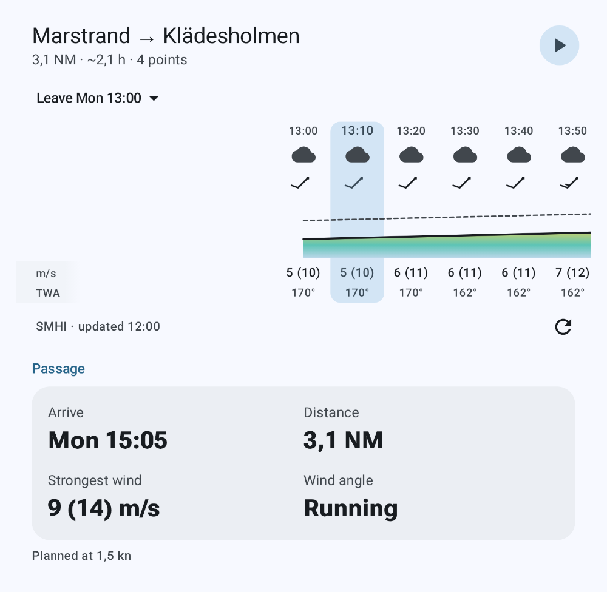
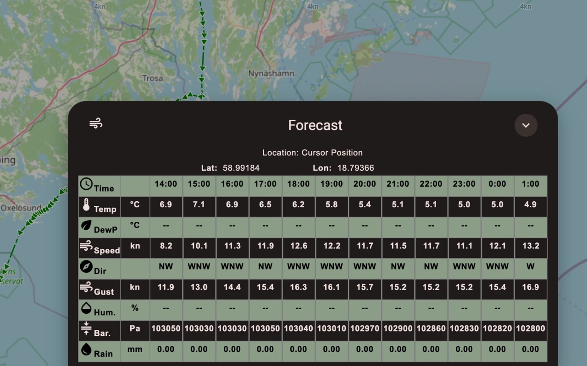
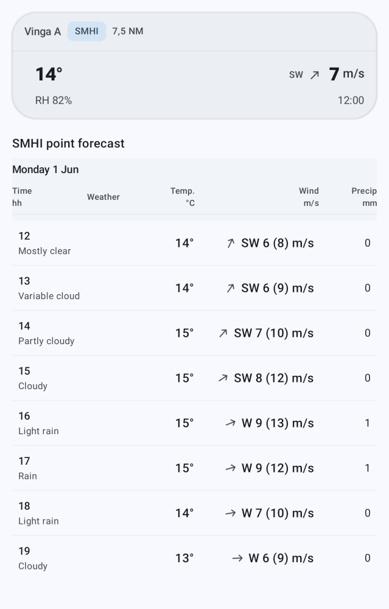

# signalk-smhi-weather-provider

A Signal K **weather provider** backed by [SMHI](https://www.smhi.se/) open data
(Sweden). Once installed, the Signal K **Weather API** and any app that uses it can
show observations, forecasts, and official weather warnings for a position. Best
coverage in and around Swedish waters.

Provides:
- **Observations** — latest readings from the nearest SMHI station.
- **Forecasts** — point forecasts (hourly, plus a derived daily summary).
- **Warnings** — SMHI's official impact-based weather warnings.

## Screenshots



*SMHI wind forecast along a planned route, timed to where the boat will be each hour.*



*Freeboard-SK's forecast panel at a map position.*



*Latest reading from the nearest SMHI station, and the hourly point forecast.*

## Requirements

- **Signal K server v2** with the Weather API (server 2.x). The plugin registers
  itself as a weather provider on startup.

## Install

1. **App Store (recommended):** Admin UI → **Appstore → Available**, search
   `signalk-smhi-weather-provider`, install, restart the server, then enable it under
   **Server → Plugin Config**.
2. **CLI:** `cd ~/.signalk && npm install signalk-smhi-weather-provider`, restart the
   server, then enable it in Plugin Config.

It works out of the box, no configuration is required.

## Using it

Weather-aware Signal K apps pick up the provider automatically. To check it directly,
call the Weather API with a latitude and longitude:

```http
GET /signalk/v2/api/weather/observations?lat=59.33&lon=18.07
GET /signalk/v2/api/weather/forecasts/point?lat=59.33&lon=18.07&count=12
GET /signalk/v2/api/weather/warnings?lat=59.33&lon=18.07
```

Running more than one weather provider? Add `&provider=smhi-weather-provider` to pick
this one. List installed providers at `GET /signalk/v2/api/weather/_providers`.

## Configuration

All optional — the defaults are fine for most boats.

| Setting | Default | What it does |
|---|---|---|
| **Follow the vessel position** | off | Periodically fetch weather for your current position and publish it on the Signal K stream (context `smhi`), so weather follows the boat. |
| **Update interval** | 60 min | How often to refresh when following the vessel (15 / 30 / 60). |
| **Max weather-station distance** | 150 km | Observations come from the nearest SMHI station; beyond this, observations are empty. |
| **Debug logging** | off | Extra detail in the Signal K log. |
| **Warnings feed path** (advanced) | `/ibww/active.json` | Only change if warnings stop working because SMHI moved their feed. |

## Develop

```bash
npm install
npm test
npm run build
node dist/smoke.js   # quick live check against SMHI
```

## Note

Parts of this plugin were written with AI agent assistance. Reviewed and tested before
release; issues and PRs welcome.
